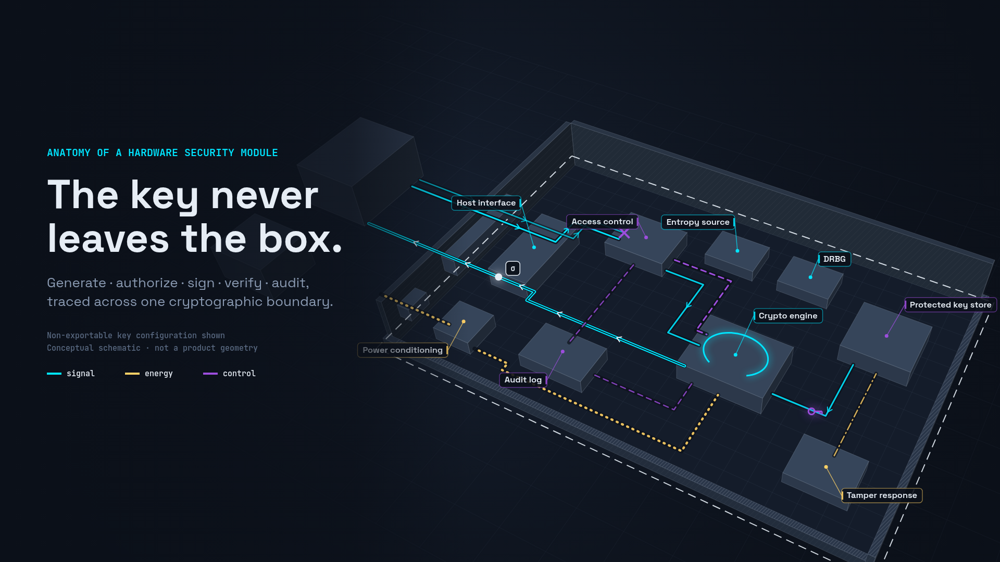

<!--
SEO PACKAGE (not part of the Medium body)

SEO title (≤60 chars):  How a Hardware Security Module Works, Frame by Frame
Medium title:           The Key Never Leaves the Box: An Anatomy of a Hardware Security Module
Subtitle:               A 34-second, code-rendered explainer that traces one signing request through an HSM, from key generation to audit, and is clear about what it does not prove.
Meta description (≤155): What a hardware security module does: key generation, authorization, internal signing, verification, and audit, traced across one cryptographic boundary.
Slug:                   hardware-security-module-anatomy-explained
Primary keyword:        hardware security module
Secondary keywords:     what is an HSM, HSM key generation, non-exportable keys, HSM signing, cryptographic boundary, HSM audit log, key management
Medium tags (max 5):    Cybersecurity, Cryptography, Key Management, Information Security, Data Visualization
Canonical URL:          https://mizcausevic-dev.github.io/hsm-anatomy-motion-explainer/ (set as canonical if the explainer page is the primary home)
Hero image:             hero-Cursor.png (1920×1080)
Hero alt text:          Conceptual cutaway of a hardware security module showing a host request in cyan, access-control and audit paths in violet, and power in gold, all inside a dashed cryptographic boundary.
Hero caption:           Conceptual schematic rendered from code. Not a product geometry.
-->


*Conceptual schematic rendered from code. Not a product geometry.*

# The Key Never Leaves the Box: An Anatomy of a Hardware Security Module

### A 34-second, code-rendered explainer that traces one signing request through an HSM, from key generation to audit, and is clear about what it does not prove.

A hardware security module exists to make one sentence true: **the private key is used where it lives, and only the result leaves.** The rest of the device, including the entropy source, the access-control layer, the crypto engine, the audit log, and the tamper response, either supports that sentence or records whether it held.

Most HSM explainers stop at the definition. I wanted to watch the mechanism, so I built a frame-exact motion explainer that follows one request across one cryptographic boundary. It runs 1,020 frames at 30 fps, every frame is a pure function of its index, and you can scrub it in the browser:

**▶ Live explainer:** [mizcausevic-dev.github.io/hsm-anatomy-motion-explainer](https://mizcausevic-dev.github.io/hsm-anatomy-motion-explainer/)
**Source:** [github.com/mizcausevic-dev/hsm-anatomy-motion-explainer](https://github.com/mizcausevic-dev/hsm-anatomy-motion-explainer)

This article walks through what each stage shows, why the stage matters, and where the diagram deliberately stops making claims.

---

## What is a hardware security module?

NIST's glossary gives the definition this explainer is built on:

> "A physical computing device that safeguards and manages cryptographic keys and provides cryptographic processing. An HSM is or contains a cryptographic module."
> NIST CSRC Glossary, citing NIST SP 800-57 Part 2 Rev. 1

The same glossary entry carries a second definition, sourced to NIST SP 1800-16: a device that provides "tamper-evident and intrusion-resistant safeguarding and management of digital keys and other secrets, as well as crypto-processing," and notes that FIPS 140-2 specifies requirements for HSMs. FIPS 140-3 is the current revision of that standard.

That definition has three verbs: **safeguard**, **manage**, and **process**. Every animated element in the explainer maps to one of them. I cut anything that didn't.

## Why an "anatomy" format works for security hardware

Security architecture is usually taught as boxes and arrows. The problem with boxes and arrows is that they flatten the one thing that matters most in an HSM: **which side of the boundary each piece of data is on, at each moment.**

An anatomy view adds two things a static diagram lacks:

1. **Time.** You see the order of operations. Policy approves before the engine runs, and the key loads after authorization, not before.
2. **Place.** You see where data physically goes. The request arrives on one lane, the signature leaves on a different lane, and the private key moves only a short internal distance between the key store and the engine.

The explainer uses a fixed color contract so you can read causality without reading labels:

| Color | Meaning |
|---|---|
| Cyan `#00E5FF` | Transport or signal (requests, digests, signatures) |
| Gold `#FFD166` | Energy or actuation (power in, zeroize path) |
| Violet `#9D4EDD` | Control or state (policy, grants, key attributes, audit) |
| Neutral `#344257` | Physical material |

These colors are explanatory overlays. They do not represent light emitted by the device.

---

## Stage 1 · Reveal the boundary (0–5 s)

The explainer opens on the full assembly, with the host application sitting *outside* the chassis. A dashed line traces the **cryptographic boundary**, the perimeter inside which keys and security-relevant processing live. The lid lifts away and the near walls are sectioned so you can see in. The frame labels that cut as illustrative.

Two things are established before anything moves:

- **The host is not trusted with keys.** It sits on the far side of the boundary and will only ever send requests.
- **The perimeter is active.** A tamper-sensing envelope and a gold zeroize path are drawn and labeled *design-dependent*. Tamper response is real and widely discussed, but how a given product implements it is not something a conceptual diagram can establish, so the explainer doesn't pretend to.

The camera then makes a measured three-quarter push toward the active region. The move is deliberately slow, because the viewer needs a stable mental map before the first packet moves.

## Stage 2 · Generate the key inside (5–10 s)

The close-up isolates the four components the mechanism needs and dims everything else:

1. **Entropy source.** Physical noise is conditioned into seed material. NIST SP 800-90B covers entropy sources.
2. **DRBG.** A deterministic random bit generator expands the seed into random bits. NIST SP 800-90A covers DRBG mechanisms.
3. **Crypto engine.** The engine derives key pair K1 from those bits.
4. **Protected key store.** K1 is stored with its attributes.

The important artifact here is not the key. It's the **attribute card** that appears next to the key store:

```
private part   stays in key store
EXPORTABLE     false  ← selected
usage          SIGN only
public part    may leave boundary
```

### Non-exportability is a choice, not physics

The brief for this piece had one explicit technical limit: *non-exportability is an explicit selected configuration.* That phrasing matters, and it's the most common thing HSM marketing blurs.

An HSM does not make every key unexportable by nature. Keys carry attributes, and the module's policy enforces them. A key created as non-exportable stays inside. Many real deployments also need controlled export, such as wrapped backup or replication between modules, and those are configurations too. The explainer shows one configuration and labels it as selected, so nobody walks away believing the diagram describes a law of hardware.

## Stage 3 · Authorize the request (10–17 s)

Now the host speaks. It sends `SIGN(handle K1, H(m))` with a credential. Notice what it sends: a **handle** to the key, not the key, and a **digest** of the message.

The camera tracks the causal path from host to host interface to access control to engine. Three lanes stay visually distinct for the whole stage:

- **Input lane** (solid cyan) carries the request in.
- **Output lane** (hollow cyan) is drawn but idle, labeled as such. No response travels before authorization.
- **Control** (dashed violet) carries the grant from access control to the engine.

Access control runs four checks, which appear one at a time:

```
✓ session authenticated
✓ role permits SIGN
✓ K1 usage includes sign
✓ handle K1 resolves
```

Only then does a violet grant token reach the engine, followed by the digest on its own cyan trace.

### The denied request is the point

Midway through the stage, a second request arrives: `EXPORT(K1.private)`. It travels the same input lane, reaches access control, and stops at a violet ✕ labeled `DENIED · K1 export = false`.

I put the denial in the explainer because it is the most instructive frame in the piece. **The boundary is enforced by policy evaluated inside the module, not by geometry.** The chassis keeps attackers' probes out. The policy engine is what refuses a well-formed, authenticated API call that asks for something the key's attributes forbid. Both events, the grant and the denial, send a violet pulse to the audit log.

## Stage 4 · Sign internally (17–25 s)

The camera closes on the crypto engine and the key store. The private key, drawn as a violet key glyph and labeled `sk_K1 · internal only`, makes the shortest move in the entire video: from the key store to the engine, inside the boundary.

A ring sweeps the engine top while it computes. A qualitative inset on the right states what's happening in notation:

```
σ = Sign( sk_K1 , H(m) )
```

The inset is labeled *mathematical notation, not a measurement*. It describes a relationship. It is not a timing diagram or a benchmark.

### Energy accounting, kept honest

While the engine works, the gold power trace into it pulses faster and faint heat lines rise above it, with a chip reading `power in → heat out (qualitative)`. Electrical energy that enters a computing device leaves as heat. The explainer keeps that accounting visible without inventing a wattage, a temperature, or an efficiency, because none of those would be true of "an HSM" in general.

### The boundary ledger

When the signature `σ` leaves on the output lane, a second inset tallies exactly what crossed the boundary for this request:

| Direction | What crossed |
|---|---|
| **In** | request, credential, H(m) |
| **Out** | σ, status code |
| **Never** | sk_K1 |

If you take one artifact from this article into a design review, take this table. For any HSM-backed flow you own, you should be able to fill it in, and the bottom row should contain every private key in scope.

## Stage 5 · Verify and audit (25–34 s)

The camera pulls back to a stable overview and holds. Three things resolve.

**Verification happens outside.** The public key leaves the boundary on an output trace labeled *exportable by design*. A relying party receives `m + σ` and computes `Verify(pub K1, m, σ) → valid`. No HSM is involved in verification. That asymmetry is the economic logic of signing: one guarded secret, unlimited public checks.

**The module records what it did.** An append-only audit panel fills in entry by entry:

```
e1  GENERATE K1   export=false
e2  SIGN K1       authorized
e3  EXPORT K1     denied
e4  SIGN K1       σ returned
```

Each entry is shown chained to the previous one, as in `h3 = H(h2 ‖ e3)`, and the panel states plainly that the chaining is conceptual and real log formats vary by product. The denial is logged. In practice, the refused request is often more interesting to an investigator than the approved ones.

**The limits stay on screen.** The final frame does not end on a triumphant logo. It ends on a scope panel:

- **Protects keys, not intent.** An authorized caller can still sign a malicious message.
- **Authorization is only as strong as credential and role management** outside the box.
- **Export = false is a selected configuration.**
- **Tamper response, side-channel resistance, and certification level are design-specific.** Not shown.
- **Power in becomes heat.** Qualitative, not measured.

That first bullet is where many real HSM incidents live. The module did its job and protected the key. The weakness was upstream: who was allowed to ask for a signature, and over what.

---

## How the explainer is built (for the developers reading)

The whole piece is a TypeScript + Canvas 2D app with no animation library. Three design decisions make it work as an explainer rather than a demo reel.

### 1. Every frame is a pure function of its index

```ts
export function renderFrame(ctx: CanvasRenderingContext2D, frame: number, opts: RenderOptions = {}) {
  const f = clamp(Math.round(frame), 0, LAST_FRAME);
  const cam = sampleCamera(CAMERA, f);
  const proj = makeProjector(cam, W, H);
  // geometry → overlays → insets → HUD
}
```

There is no `Math.random()` at render time. Entropy "bits" flicker from a seeded hash of the frame number. Scrubbing to frame 486 always shows the same denial, so the browser player, single-frame stepping, and the exported MP4 all agree.

### 2. A storyboard file that a reviewer can audit

Chapters, camera keyframes, captions, and every event marker live in one file. Reviewing the explainer for accuracy means reading `storyboard.ts`, not reverse-engineering animation code:

```ts
export const T = {
  checks:       [392, 446],
  authorize:    [430, 470],
  exportTravel: [452, 486],
  denied:       [484, 509],
  keyLoad:      [528, 578],
  respTravel:   [642, 716],
  // …
} as const;
```

### 3. Lanes are data, not decoration

Input and output paths are separate polylines in the model, offset so a request and a response can never share a drawn path. Each trace has a typed `kind` (`input`, `output`, `control`, `energy`, `actuation`) that fixes its color and stroke. Getting the color contract wrong would require changing a type, not a hex value scattered across the code.

The exporter drives the same `renderFrame()` in headless Chrome and pipes PNGs to ffmpeg, so the video file is exactly the player's output:

```bash
npm run dev
npm run render:video   # → 1920×1080, 30 fps, 1,020 frames
```

## What this explainer is, and what it isn't

It **is** a conceptual schematic of the mechanism NIST describes: safeguard keys, manage them, and process with them inside a boundary.

It **is not** a product geometry, a certified design, a simulation result, or a claim about any vendor's internals. It contains no dimensions, throughput figures, or certification levels, because a general explainer can't truthfully supply them. Camera moves, palette, cutaways, and timing are original illustrative choices.

Those constraints didn't weaken the piece. They sharpened it. When you can't lean on numbers, you have to make the **mechanism** legible, and the mechanism is what people need to reason about their own systems.

## FAQ

**What does a hardware security module do?**
It safeguards and manages cryptographic keys and performs cryptographic operations, such as signing, inside a protected physical boundary, so applications can use keys without holding them.

**Does the private key ever leave an HSM?**
Not when the key is configured as non-exportable, which is the configuration shown here. Some deployments permit controlled, wrapped export for backup or replication. That's a configuration choice, enforced by the module's policy.

**Do you need an HSM to verify a signature?**
No. Verification uses the public key, which can be distributed freely. Only signing requires the private key.

**What doesn't an HSM protect against?**
Misuse by an authorized caller. If an attacker can get a legitimate signing request approved, the HSM will sign it. Credential management, role design, and what you allow to be signed sit outside the box.

**Is the audit log in an HSM tamper-proof?**
Implementations vary. The explainer shows hash chaining conceptually and does not claim any specific product's log format or integrity guarantees.

## Try it, fork it

Scrub the explainer at [mizcausevic-dev.github.io/hsm-anatomy-motion-explainer](https://mizcausevic-dev.github.io/hsm-anatomy-motion-explainer/). Press `1`–`5` to jump between stages, or `←`/`→` to step frames. Then open the boundary ledger for one of your own HSM-backed flows and fill in the three rows.

The engine is domain-agnostic: a keyframed camera, a projected box model, typed overlay lanes, and inset panels. Swap two files and it explains a TPM attestation flow, a payment terminal's PIN path, or a zero-trust gateway. The [source is on GitHub](https://github.com/mizcausevic-dev/hsm-anatomy-motion-explainer).

---

*Reference: [NIST CSRC Glossary, "Hardware Security Module (HSM)"](https://csrc.nist.gov/glossary/term/hardware_security_module_hsm). This piece is illustrative only. It is not a certified design, a simulation result, or a claim about any commercial implementation.*

*Mirza Causevic builds web platforms and security-aware systems at [Kinetic Gain](https://kineticgain.com).*
